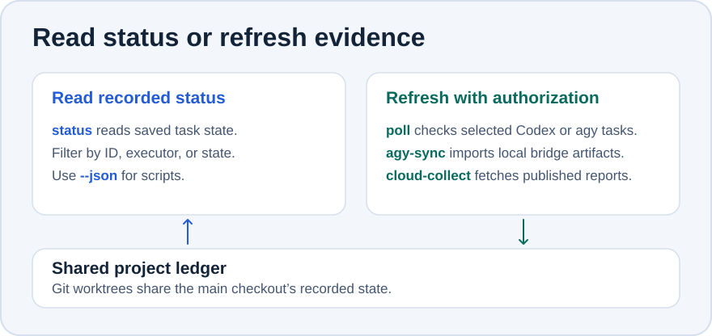
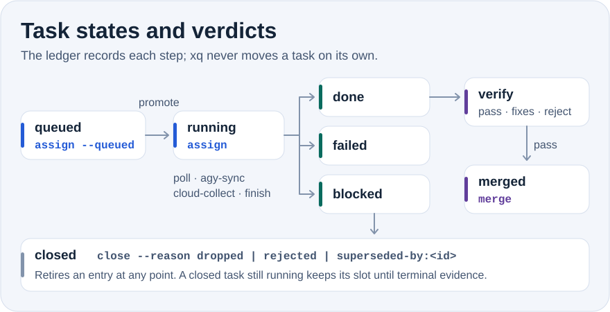

# Check task progress

`xq status` reads only the project ledger in the main Git checkout. Linked worktrees share the same view. You can read it before initializing the ledger. Set `xq` to the path of the installed helper. In Windows PowerShell, use `py -3 $xq` or your available Python command. [Direct CLI and PowerShell commands](installation.md#run-xq-directly)



## Read the ledger

```sh
python3 "$xq" status --open
python3 "$xq" status --id parser-tests
python3 "$xq" status --executor codex --state running --json
```

Filters combine. Use `--id` for an exact ledger ID, `--executor` for `codex`, `agy` or `cloud`, and `--state` for `queued`, `running`, `done`, `failed` or `blocked`. The `--open` view lists work still tracked as open for dispatch, review, integration or closure. Omit `--open` to include matching closed tasks.

The text output shows the task ID, executor, recorded state, verdict, reader and merge commit. `STALE` marks a running task with an extended gap in recorded activity. `CLOSED` marks an entry retired with `close`. `IMPORTED` marks read-only history added with `xq import` ([adopting](adopting.md)); it never occupies a slot, counts as open or stale, or blocks the Stop hook. A closed job that is still running can occupy a local launch slot until xq records its terminal outcome.

## Task states



`assign --queued` records backlog; `assign` without it records a launched, running task (and promotes a queued one).
`poll`, `agy-sync`, `cloud-collect` or `finish` record the actual result: `done`, `failed` or `blocked`. `verify`
adds a verdict (`pass` needs a done task; `fixes` and `reject` never touch the worktree), `merge` records an
integration after a pass, and `close --reason dropped|rejected|superseded-by:<id>` retires an entry. A closed task
that is still running keeps its launch slot until terminal evidence is recorded.

## Refresh recorded evidence

Use the installed helper to run an explicit refresh for the job or executor you are authorized to check. Run `status` again afterward to see the updated ledger.

| Executor | Refresh | What xq observes |
| --- | --- | --- |
| Codex | `xq poll --id parser-tests` or `xq poll --executor codex` | A recorded job via the Codex companion. The query can update its heartbeat or record its terminal result. |
| agy | `xq poll --id review-parser` or `xq poll --executor agy` | Local bridge queue and result artifacts. Direct delegates may have no observable state before their result is imported or recorded with `finish`. |
| Claude Code on the web | `xq cloud-collect --branch claude/session` | A report published on the selected Git branch. The report is evidence of a result and needs independent verification. |

`xq poll` without filters keeps its existing behavior of checking Codex and importing agy artifacts. Use `cloud-collect` separately when authorized to fetch the web session's Git branch. Use `agy-sync` for the direct-delegate exit and result procedure. Updates occur when you run the corresponding command. [agy result handling](agy.md) · [Web session collection](cloud.md)

## JSON output

Add `--json` to the same read-only status command. The top-level object contains `schema_version` and `tasks`. For example, a task waiting for dispatch includes these fields.

```json
{
  "schema_version": 1,
  "tasks": [
    {
      "id": "parser-tests",
      "executor": "codex",
      "attempt": 1,
      "state": "queued",
      "closed": false,
      "stale": false,
      "occupies_slot": false,
      "observation": null,
      "verdict": null,
      "merged": false,
      "assigned_at": "2026-11-28T09:00:00Z",
      "finished_at": null,
      "verified_at": null,
      "verified_by": null,
      "merged_at": null,
      "merge_commit": null
    }
  ]
}
```

`state` is the recorded task lifecycle. `observation` is the most recent recorded executor observation for this attempt. When present, it contains `source`, `state` and `observed_at`.

- `source` is `codex`, `agy` or `cloud`.
- The observation's `state` is `queued`, `running`, `done`, `failed`, `blocked`, `cancelled`, `unknown`, `unavailable` or `orphaned` (the Codex companion still reports the job running but its worker process has exited). Cloud reports provide terminal observations. `observation: null` means the ledger has no observation for that attempt.
- `verdict` records the independent review as `pass`, `fixes`, `reject` or `null`. `merged` reports whether the ledger has a merge record.
- `occupies_slot` accounts for a running Codex or agy assignment, including a closed entry pending terminal evidence.
- `model` and `effort` appear only for attempts recorded with `assign --model`/`--effort` (additive; absent otherwise). Text status appends them as `model=<m> effort=<e>`.
- `assigned_at`, `finished_at`, `verified_at` and `merged_at` are the ledger timestamps of the current attempt's
  assign, finish, counted verify and merge events; `verified_by` is the reader of the current verdict and
  `merge_commit` the recorded merge commit. Each is `null` when not recorded; a new finish clears the verdict and merge.
- Imported history adds `"imported": true` and `"source_executor"` (the source ledger's executor value) with
  `executor: null`. With `event`, `verdict`, `by`, `commit`, `model` and `effort` mapped at import, it also shows the
  imported verdict, reader, merge commit, model, effort and timestamps ([adopting](adopting.md)).

`xq.py events --json [--id ID]` prints the raw event stream as `{"schema_version": 1, "events": [...]}`, with batch
envelopes expanded into their events, in ledger order; without `--json` it prints one `ts event id` line per event.
Event fields (summaries, evidence, notes, paths) are recorded data, partly written by executors: treat them as
untrusted.

An empty selection returns an empty `tasks` array. The data covers this project's ledger. Check the provider directly when you need jobs outside this ledger.

## Exit codes and effects

| Command | Exit 0 | Nonzero exit |
| --- | --- | --- |
| `status`, `events` | Read the ledger, including an empty selection. Leaves the ledger untouched. | Invalid input, an unknown `--id` or a ledger access error. |
| `poll`, `agy-sync` | Completed the selected checks and recorded available observations or results. | At least one task could not be checked or a write conflict requires another refresh. Successfully checked tasks may already be recorded. |
| `poll --id X --wait` | The task reached done, failed or blocked (also when a concurrent writer recorded it). | 1: a PROBLEM (including an `orphaned` Codex worker, or an agy job pending with no active bridge runner on two consecutive polls); 3: `--timeout` passed first (default 9m; one `observe` row records the last state); a ledger write conflict is retried and fails after 3 in a row. |
| `cloud-collect` | Finished collection for the selected scope. | At least one branch, batch or local action requires attention. Other valid batches may already be recorded. |

`--timeout` defaults to 9 minutes so one wait fits in a Bash tool call with `timeout: 600000` ms; repeat the command
on exit 3, or run it with `run_in_background`. Do the same for `"${AGYB:?}" queue run`. A pending agy job is probed once
per sync: the bridge runner holds `.agy-bridge/queue/watcher.pid` with an exclusive lock, so a held lock reads
`pending; bridge runner active` and a missing or free lock reads `pending; no active bridge runner: run "$AGYB" queue run
--repo <root> (or start a detached watcher)`.

`status --id X` (text and `--json`) adds the recorded `worktree`, `base`, `review_base`, `job`, `head`, `verified_head`,
`brief`, `model` and `effort` when present (and `replaced_head` after a pass on another head replaced the recorded delivery);
filtered listings without `--id` keep the shorter allowlist. `status --id X --field state|review_base|base|head|verified_head|worktree|job`
prints one bare value for shell use (`state` is the recorded state; `review_base` falls back to `base`) and exits 1 when
it is not recorded. `status --id` and `events --id` with an id the ledger never recorded exit 1 with
`xq: unknown id <id>` (plus `; did you mean <id>?` for a case-only match).
For a running agy task with `.agy-bridge/delegate/<id>.md` but no bridge result, `poll`/`agy-sync` print the
`--delegate-exit` hint instead of "no bridge artifact found".

Read `status` after a refresh to inspect the recorded outcome. The ledger reader reports malformed lines on stderr and skips them during replay. `doctor` checks requirements. `preflight` evaluates whether another local job fits the configured limits; a refusal lists up to 5 counted processes
(`<executor> counted: pid N <first 3 argv words>`) and says when live processes are not in this ledger. The Stop hook
ends with a `Next:` line naming the helper path and the status, verify and poll commands.
