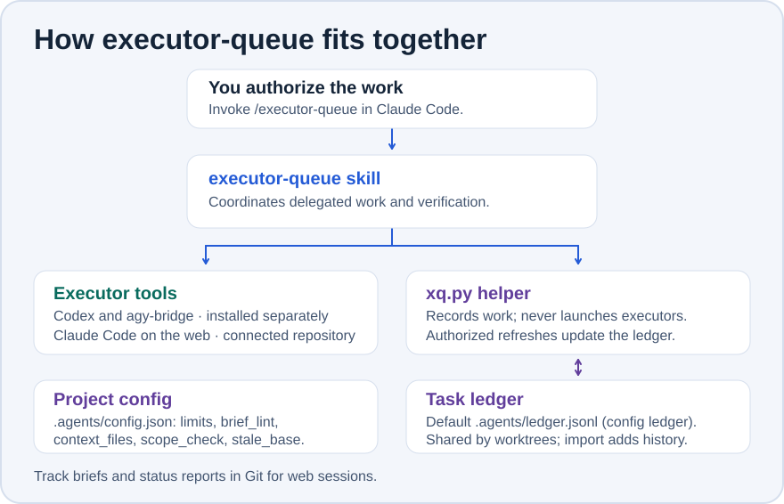

# executor-queue

**executor-queue keeps a written, checkable record of coding work you hand off from Claude Code to another AI agent.**
The agent can be Codex, the agy reviewer (Google Antigravity through agy-bridge) or Claude Code on the web. You
launch the agent yourself. The `xq` helper records what was assigned, what came back and who checked it
independently, so delegated work is not lost and is not merged unreviewed. xq never starts agents, sends files,
commits, pushes or merges.

If your project's AGENTS.md or CLAUDE.md already defines its own task queue, the skill follows that queue instead.



## Words used here

- **Executor**: the agent that does the work (Codex, agy, or a Claude Code web session).
- **Lead**: you, or the Claude Code session that delegates the work and later checks it.
- **Brief**: a Markdown task file in `.agents/briefs/`. It has one `Result:` line and ends with a `## Acceptance`
  section that lists `Files:`, `Checks:` and `Notes:`. [Example](.claude/skills/executor-queue/assets/codex-task.md)
- **Ledger**: the append-only JSONL log xq writes (`.agents/ledger.jsonl` by default). Every Git worktree of the
  project shares it.
- **Preflight**: a check that load, disk space and the number of running jobs allow one more launch.
- **Verify**: a reader other than the executor records a `pass`, `fixes` or `reject` verdict, with evidence,
  before anything is merged.

## Requirements

- Always: Claude Code or Codex, Python 3.8+ and Git 2.31+, in a Git checkout that has an initial commit.
- To install with the Skills CLI: Node.js 22.20+ with npm.
- Each executor has its own requirements; see [Choose an executor](#choose-an-executor).

## Install

Run the [Skills CLI](https://github.com/vercel-labs/skills) from the Git project where you want to use the skill:

```sh
npx skills add dominno/claude-executor-queue --skill executor-queue -a claude-code -a codex
```

Keep only the `-a` option for the agent you use. With both, the CLI stores one copy in
`.agents/skills/executor-queue` (Codex) and symlinks `.claude/skills/executor-queue` to it (Claude Code); add
`--copy` to give each agent an independent copy. Add `-g` to install for your user account (`~/.claude/skills`
and `~/.agents/skills`) and use the skill in every project. For a private repository give Git read access, and to
install without GitHub access or to try a local change, pass the absolute path of a clone instead:

```sh
npx skills add /path/to/claude-executor-queue --skill executor-queue -a claude-code -a codex
```

Updates, removal and moving from the old `install.sh` copy are covered in the
[installation guide](.claude/skills/executor-queue/references/installation.md).

Start a new session in the checkout and invoke the skill by name (it is never invoked automatically):
`/executor-queue` in Claude Code, `$executor-queue` in Codex.

```text
/executor-queue Initialize this project's task ledger and show open tasks.
```

A fresh ledger reports `no tasks`.

## Connect your executors

Connect only the executors you plan to use. Installing the tools and signing in are steps you take yourself; xq only
checks them. Every command below runs from your project checkout:

```sh
root=$(git rev-parse --show-toplevel)
xq="$root/.claude/skills/executor-queue/scripts/xq.py"   # Codex: .agents/skills/...; with -g: ~/.claude/skills/...
python3 "$xq" init
```

### Codex: code changes in a separate worktree

1. Install and sign in to the Codex CLI (needs Node.js):
   ```sh
   npm install -g @openai/codex
   codex login            # or: codex login --device-auth
   ```
2. Add the Codex plugin in Claude Code:
   ```text
   /plugin marketplace add openai/codex-plugin-cc
   /plugin install codex@openai-codex
   /codex:setup
   ```
3. Check it: `python3 "$xq" doctor --need codex` prints `OK Codex plugin` and `CC=<path>`, the path the
   [Codex quickstart](#quickstart-one-codex-task) uses. [Codex setup details](.claude/skills/executor-queue/references/codex.md#setup)

### agy: reviews of files you choose (Google Antigravity)

1. Install the agy CLI (macOS or Linux): `curl -fsSL https://antigravity.google/cli/install.sh | bash`. It goes to
   `~/.local/bin/agy`; check it with `agy --version`.
2. Sign in once: run `agy`, open the link it prints, sign in with your Google account, paste the code back into the
   terminal, then type `/exit`. `agy models` should now list models.
3. Install [agy-bridge](https://github.com/dominno/claude-agy-bridge), which checks every file before it is sent
   (needs Python 3.9+):
   ```sh
   npx skills add dominno/claude-agy-bridge --skill agy-bridge -a claude-code -a codex
   ```
4. Check it: `python3 "$xq" doctor --need agy` prints `OK agy-bridge: <path>` and `AGYB=<path>`, the path the
   [agy quickstart](#quickstart-one-agy-review) uses. [agy setup details](.claude/skills/executor-queue/references/agy.md#setup)

The files you choose for a review, and the task text, are sent to Google.

### Claude Code on the web: task batches in a remote session

1. Connect the repository in [Claude Code on the web](https://claude.ai/code) and set up its environment:
   dependencies, runtime versions, a restricted network policy and no secrets in environment settings.
2. Make sure `origin` is configured and you may push the branch that holds the briefs.
3. Check it: `python3 "$xq" doctor --need cloud`. [Cloud setup and recipes](.claude/skills/executor-queue/references/cloud.md)

## Quickstart: one Codex task

You can ask `/executor-queue` to do each step for you. The same steps, run directly, look like this. First
[connect Codex](#codex-code-changes-in-a-separate-worktree).

```sh
root=$(git rev-parse --show-toplevel)
xq="$root/.claude/skills/executor-queue/scripts/xq.py"   # Codex: .agents/skills/...; with -g: ~/.claude/skills/...
python3 "$xq" init
python3 "$xq" doctor --offline --need codex             # prints CC=<path to codex-companion.mjs>
CC='<path printed by doctor>'
branch=main                                               # your default branch

# 1. Write and check the brief
cp "${xq%/scripts/xq.py}/assets/codex-task.md" .agents/briefs/parser-empty-input.md   # then edit paths and checks
python3 "$xq" brief-lint --brief .agents/briefs/parser-empty-input.md

# 2. Give Codex its own worktree, check capacity, launch, record
wt="$root-wt/parser-empty-input"
git worktree add -b xq/parser-empty-input "$wt" "$branch"
python3 "$xq" preflight --executor codex --worktree "$wt"
node "$CC" task --background --write --cwd "$wt" --effort medium \
  --prompt-file "$root/.agents/briefs/parser-empty-input.md"    # prints a jobId
python3 "$xq" assign --id parser-empty-input --executor codex \
  --brief .agents/briefs/parser-empty-input.md --job <jobId> --worktree "$wt"

# 3. Wait for the actual result (repeat on exit 3)
python3 "$xq" poll --id parser-empty-input --wait

# 4. Review the diff, run the checks yourself, commit in the worktree, then verify
git -C "$wt" diff "$(python3 "$xq" status --id parser-empty-input --field review_base)"
python3 "$xq" verify --id parser-empty-input --by <your-name> --verdict pass \
  --head "$(git -C "$wt" rev-parse HEAD)" --evidence 'pytest tests/test_parser.py: 12 passed'

# 5. With approval, merge and record it
git merge --no-ff xq/parser-empty-input
python3 "$xq" merge --id parser-empty-input --commit "$(git rev-parse HEAD)"
```

`verify` prints `WARN SENSITIVE` (agent, hook, CI or manifest changes) and `WARN SCOPE` (paths outside the brief's
`Files:`) lines. Inspect them before you pass, and add `--ack-sensitive` when it asks for it. The full recipe,
including retries, fix loops and cleanup, is in [Codex tasks](.claude/skills/executor-queue/references/codex.md#tasks).

## Quickstart: one agy review

First [connect agy](#agy-reviews-of-files-you-choose-google-antigravity). A review sends the files you name to Google
and returns a text answer whose quotes the bridge checks against your files.

```sh
python3 "$xq" doctor --need agy                           # prints AGYB=<path to the bridge script>
AGYB='<path printed by doctor>'
printf '# review-parser\n\nResult: bugs in src/parser.py, each with a citation\n' > .agents/briefs/review-parser.md

# 1. Preview exactly what would be sent; nothing is sent
"$AGYB" dry-run --repo "$root" --file src/parser.py -- 'List bugs in parser.py, each with a citation.'

# 2. Check capacity, record the task, send it and record the bridge's exit code
python3 "$xq" preflight --executor agy
python3 "$xq" assign --id review-parser --executor agy --brief .agents/briefs/review-parser.md
"$AGYB" delegate --repo "$root" --timeout 8m --file src/parser.py --cite --require-verified \
  --out "$root/.agy-bridge/delegate/review-parser.md" -- 'List bugs in parser.py, each with a citation.'; rc=$?
python3 "$xq" agy-sync --delegate-exit "review-parser=$rc" --out "$root/.agy-bridge/delegate/review-parser.md"

# 3. Read the answer, check its claims yourself, then record your verdict in the bridge and in xq
"$AGYB" verdict --repo "$root" --job review-parser --verdict pass --by <your-name> \
  --evidence 'checked 3 quotes' --results-dir .agy-bridge/delegate
python3 "$xq" verify --id review-parser --by <your-name> --verdict pass --evidence 'checked 3 quotes'
```

`VERIFIED` next to a citation means the quoted text exists in your file, not that the claim is correct. Batches of
reviews, queued jobs and worktree reviews are in [agy review recipes](.claude/skills/executor-queue/references/agy.md).

## Choose an executor


| If you need | Executor | Before you start ([how to connect](#connect-your-executors)) |
| --- | --- | --- |
| A code change in a separate Git worktree | [Codex](.claude/skills/executor-queue/references/codex.md) | Node.js, an authenticated Codex CLI and the Claude Code Codex plugin. |
| A review of specific files | [agy-bridge](.claude/skills/executor-queue/references/agy.md) | macOS or Linux, Python 3.9+, an authenticated Google Antigravity CLI and [agy-bridge](https://github.com/dominno/claude-agy-bridge) (installed as a skill or plugin) with queue and verdict support. |
| A task in a remote Claude Code session | [Claude Code on the web](.claude/skills/executor-queue/references/cloud.md) | A connected repository, a reviewed brief pushed to the approved branch, and the required build tools in the remote environment. |

Check the local prerequisites with `python3 "$xq" doctor --offline --need codex`, replacing `codex` with `agy` or
`cloud` as needed. Run `preflight` right before each Codex or agy launch.

## Follow one task


A task is `queued` (recorded, waiting for dispatch), then `running`, then `done`, `failed` or `blocked`.
A reader's verdict and an optional merge follow, and `close` retires an entry at any point.
[State diagram](.claude/skills/executor-queue/references/job-status.md#task-states). After the executor returns, inspect the full delivery before
you apply changes or run tests.

## Commands

All commands are `python3 "$xq" <command>`. Use `--help` on any of them for every flag.

| Purpose | Commands |
| --- | --- |
| Set up | `init` (create `.agents/`, exclude private state) · `doctor` (check tools and auth) · `import` (add an existing JSONL ledger as read-only history) |
| Plan | `brief-lint` (check a brief's shape) · `compose` (prepend `context_files` to a brief) · `preflight` (check capacity before a launch) |
| Record | `assign` (a launched or `--queued` task) · `finish` (the actual result) · `cloud-envelope` (record a web batch and print its `/goal` message) |
| Refresh | `poll` (Codex jobs, agy artifacts; `--wait` blocks) · `agy-sync` (agy delegate results) · `cloud-collect` (web session reports) |
| Review | `status` (read the ledger; `--open`, `--json`) · `verify` (record a verdict) · `merge` (record an integration done in Git) |
| Maintain | `ack` (silence a long healthy job) · `pause` (pause hook checks for an executor) · `close` (retire an entry) · `hook` (Stop hook) |

Exit codes: 0 means success; 1 means refused, failed or a PROBLEM; 2 means a usage error, or the hook found work
that needs attention; 3 means `poll --wait` timed out.

## Configuration

Policy lives in an optional `.agents/config.json`. Every key has a default, so you can start without one.

```json
{"limits": {"codex": 2, "agy": 1}, "brief_lint": {"mode": "warn"}, "scope_check": "warn", "stale_base": "warn"}
```

Keys: `keep_busy`, `paused`, `limits`, `min_free_gb`, `max_load_per_cpu`, `main`, `context_files`, `brief_lint`,
`scope_check`, `stale_base`, `ledger` and `import_map`. Each one is described in
[Configuration](.claude/skills/executor-queue/references/configuration.md).

## What gets shared

- **Local state.** Keep the ledger, lock, review exports and `.agy-bridge/` output out of Git; `xq init` adds the
  local exclusions. The exception is a ledger you move outside `.agents/` with config `ledger`: that one is
  project history you commit ([adopting](.claude/skills/executor-queue/references/adopting.md)). Review `.agents/config.json` before tracking it.
- **Codex.** Use a separate worktree and keep sensitive files out of scope. The brief's read boundary is an
  instruction, not OS isolation. [Worktree setup](.claude/skills/executor-queue/references/codex.md#tasks)
- **agy.** The bridge sends the approved nonconfidential files and the task to Google. Inspect the manifest before
  sending, and use a trusted host. [Manifest and result checks](.claude/skills/executor-queue/references/agy.md)
- **Web sessions.** Track the brief and result status files in Git. Review outgoing commits and confirm the push
  destination before authorizing publication. [Web session setup and push scope](.claude/skills/executor-queue/references/cloud.md)

## Documentation

- [Installation and direct CLI use](.claude/skills/executor-queue/references/installation.md)
- [Codex recipes](.claude/skills/executor-queue/references/codex.md): setup, tasks, preflight, brief lint, declared scope, stale base, context preamble
- [agy review recipes](.claude/skills/executor-queue/references/agy.md)
- [Cloud batch recipes](.claude/skills/executor-queue/references/cloud.md)
- [Task status, states and refresh](.claude/skills/executor-queue/references/job-status.md)
- [Configuration](.claude/skills/executor-queue/references/configuration.md)
- [Adopting xq in a project with an existing ledger](.claude/skills/executor-queue/references/adopting.md)
- [Examples: briefs, jobs, config and Stop hooks](.claude/skills/executor-queue/assets/)
- [Changelog](CHANGELOG.md)

## Contributing and tests

Everything the skill needs lives in [`.claude/skills/executor-queue/`](.claude/skills/executor-queue/): `SKILL.md`, `scripts/` (`xq.py` and its `executor_queue/` package), `references/` and `assets/`.
`.agents/skills/executor-queue` is a symlink to it for Codex. Keep the helper compatible with Python 3.8 and the
standard library. See [CONTRIBUTING](CONTRIBUTING.md). Run the offline test suite from this repository, with `pytest` and Git
available:

```sh
python3 -m pytest -q tests
git diff --check
```

The code layout (CORE, PORT, ADAPTERS, CLI) and how to add a new executor connector are described in
[CONTRIBUTING](CONTRIBUTING.md#code-layout).

See the [changelog](CHANGELOG.md) for version changes. The project is
released under the [MIT license](LICENSE). Use the [security policy](SECURITY.md) to report a vulnerability.
