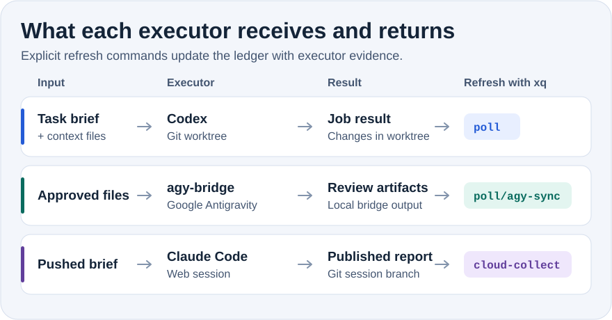
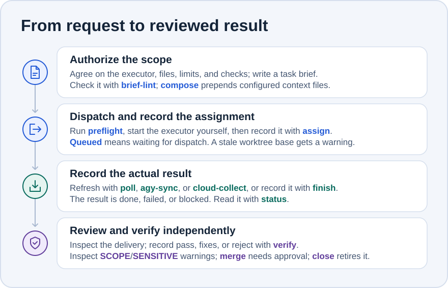

# executor-queue

**executor-queue keeps a written, checkable record of coding work you hand off from Claude Code to another AI agent.**
The agent can be Codex, the agy reviewer (Google Antigravity through agy-bridge) or Claude Code on the web. You
launch the agent yourself. The `xq` helper records what was assigned, what came back and who checked it
independently, so delegated work is not lost and is not merged unreviewed. xq never starts agents, sends files,
commits, pushes or merges.

If your project's AGENTS.md or CLAUDE.md already defines its own task queue, the skill follows that queue instead.


## Words used here

- **Executor**: the agent that does the work (Codex, agy, or a Claude Code web session).
- **Lead**: you, or the Claude Code session that delegates the work and later checks it.
- **Brief**: a Markdown task file in `.agents/briefs/`. It has one `Result:` line and ends with a `## Acceptance`
  section that lists `Files:`, `Checks:` and `Notes:`. [Example](examples/codex-task.md)
- **Ledger**: the append-only JSONL log xq writes (`.agents/ledger.jsonl` by default). Every Git worktree of the
  project shares it.
- **Preflight**: a check that load, disk space and the number of running jobs allow one more launch.
- **Verify**: a reader other than the executor records a `pass`, `fixes` or `reject` verdict, with evidence,
  before anything is merged.

## Requirements

- Always: Claude Code, Python 3.8+ and Git 2.31+, in a Git checkout that has an initial commit.
- To install with the Skills CLI: Node.js 22.20+ with npm.
- Each executor has its own requirements; see [Choose an executor](#choose-an-executor).

## Install

```sh
npx skills add dominno/claude-executor-queue --skill executor-queue -a claude-code
```

Add `-g` to make the skill available in all projects. For a private repository, give Git read access, or replace
the GitHub name with the path to a local clone. Without network access, use `install.sh` or `install.ps1`
([offline installation](docs/installation.md#offline-installation)). Updates and removal are covered in the
[installation guide](docs/installation.md#update-or-remove-a-skills-cli-installation).

Start a new Claude Code session in the checkout and invoke the skill by name (it is never invoked automatically):

```text
/executor-queue Initialize this project's task ledger and show open tasks.
```

A fresh ledger reports `no tasks`.

## Quickstart: one Codex task

You can ask `/executor-queue` to do each step for you. The same steps, run directly, look like this.
[Codex setup](docs/codex.md#setup) covers installing Codex and its Claude Code plugin.

```sh
root=$(git rev-parse --show-toplevel)
xq="$root/.claude/skills/executor-queue/scripts/xq.py"   # or the path under ~/.claude/skills
python3 "$xq" init
python3 "$xq" doctor --offline --need codex             # prints CC=<path to codex-companion.mjs>
CC='<path printed by doctor>'
branch=main                                               # your default branch

# 1. Write and check the brief
cp <path-to-this-repo>/examples/codex-task.md .agents/briefs/parser-empty-input.md   # then edit paths and checks
python3 "$xq" brief-lint --brief .agents/briefs/parser-empty-input.md

# 2. Give Codex its own worktree, check capacity, launch, record
wt="$root-wt/parser-empty-input"
git worktree add -b xq/parser-empty-input "$wt" "$branch"
python3 "$xq" preflight --executor codex --worktree "$wt"
node "$CC" task --background --write --cwd "$wt" --effort medium \
  --prompt-file "$root/.agents/briefs/parser-empty-input.md"    # prints a jobId
python3 "$xq" assign --id parser-empty-input --executor codex \
  --brief .agents/briefs/parser-empty-input.md --job <jobId> --worktree "$wt"

# 3. Wait for the actual result (repeat on exit 3)
python3 "$xq" poll --id parser-empty-input --wait

# 4. Review the diff, run the checks yourself, commit in the worktree, then verify
git -C "$wt" diff "$(python3 "$xq" status --id parser-empty-input --field review_base)"
python3 "$xq" verify --id parser-empty-input --by <your-name> --verdict pass \
  --head "$(git -C "$wt" rev-parse HEAD)" --evidence 'pytest tests/test_parser.py: 12 passed'

# 5. With approval, merge and record it
git merge --no-ff xq/parser-empty-input
python3 "$xq" merge --id parser-empty-input --commit "$(git rev-parse HEAD)"
```

`verify` prints `WARN SENSITIVE` (agent, hook, CI or manifest changes) and `WARN SCOPE` (paths outside the brief's
`Files:`) lines. Inspect them before you pass, and add `--ack-sensitive` when it asks for it. The full recipe,
including retries, fix loops and cleanup, is in [Codex tasks](docs/codex.md#tasks).

## Choose an executor



| If you need | Executor | Before you start |
| --- | --- | --- |
| A code change in a separate Git worktree | [Codex](docs/codex.md) | Node.js, an authenticated Codex CLI and the Claude Code Codex plugin. |
| A review of specific files | [agy-bridge](docs/agy.md) | macOS or Linux, Python 3.9+, an authenticated Google Antigravity CLI and the [agy-bridge plugin](https://github.com/dominno/claude-agy-bridge) with queue and verdict support. |
| A task in a remote Claude Code session | [Claude Code on the web](docs/cloud.md) | A connected repository, a reviewed brief pushed to the approved branch, and the required build tools in the remote environment. |

Check the local prerequisites with `python3 "$xq" doctor --offline --need codex`, replacing `codex` with `agy` or
`cloud` as needed. Run `preflight` right before each Codex or agy launch.

## Follow one task



A task is `queued` (recorded, waiting for dispatch), then `running`, then `done`, `failed` or `blocked`.
A reader's verdict and an optional merge follow, and `close` retires an entry at any point.
[State diagram](docs/job-status.md#task-states). After the executor returns, inspect the full delivery before
you apply changes or run tests.

## Commands

All commands are `python3 "$xq" <command>`. Use `--help` on any of them for every flag.

| Purpose | Commands |
| --- | --- |
| Set up | `init` (create `.agents/`, exclude private state) · `doctor` (check tools and auth) · `import` (add an existing JSONL ledger as read-only history) |
| Plan | `brief-lint` (check a brief's shape) · `compose` (prepend `context_files` to a brief) · `preflight` (check capacity before a launch) |
| Record | `assign` (a launched or `--queued` task) · `finish` (the actual result) · `cloud-envelope` (record a web batch and print its `/goal` message) |
| Refresh | `poll` (Codex jobs, agy artifacts; `--wait` blocks) · `agy-sync` (agy delegate results) · `cloud-collect` (web session reports) |
| Review | `status` (read the ledger; `--open`, `--json`) · `verify` (record a verdict) · `merge` (record an integration done in Git) |
| Maintain | `ack` (silence a long healthy job) · `pause` (pause hook checks for an executor) · `close` (retire an entry) · `hook` (Stop hook) |

Exit codes: 0 means success; 1 means refused, failed or a PROBLEM; 2 means a usage error, or the hook found work
that needs attention; 3 means `poll --wait` timed out.

## Configuration

Policy lives in an optional `.agents/config.json`. Every key has a default, so you can start without one.

```json
{"limits": {"codex": 2, "agy": 1}, "brief_lint": {"mode": "warn"}, "scope_check": "warn", "stale_base": "warn"}
```

Keys: `keep_busy`, `paused`, `limits`, `min_free_gb`, `max_load_per_cpu`, `main`, `context_files`, `brief_lint`,
`scope_check`, `stale_base`, `ledger` and `import_map`. Each one is described in
[Configuration](docs/configuration.md).

## What gets shared

- **Local state.** Keep the ledger, lock, review exports and `.agy-bridge/` output out of Git; `xq init` adds the
  local exclusions. The exception is a ledger you move outside `.agents/` with config `ledger`: that one is
  project history you commit ([adopting](docs/adopting.md)). Review `.agents/config.json` before tracking it.
- **Codex.** Use a separate worktree and keep sensitive files out of scope. The brief's read boundary is an
  instruction, not OS isolation. [Worktree setup](docs/codex.md#tasks)
- **agy.** The bridge sends the approved nonconfidential files and the task to Google. Inspect the manifest before
  sending, and use a trusted host. [Manifest and result checks](docs/agy.md)
- **Web sessions.** Track the brief and result status files in Git. Review outgoing commits and confirm the push
  destination before authorizing publication. [Web session setup and push scope](docs/cloud.md)

## Documentation

- [Installation and direct CLI use](docs/installation.md)
- [Codex recipes](docs/codex.md): setup, tasks, preflight, brief lint, declared scope, stale base, context preamble
- [agy review recipes](docs/agy.md)
- [Cloud batch recipes](docs/cloud.md)
- [Task status, states and refresh](docs/job-status.md)
- [Configuration](docs/configuration.md)
- [Adopting xq in a project with an existing ledger](docs/adopting.md)
- [Examples: briefs, jobs, config and Stop hooks](examples/)
- [Changelog](CHANGELOG.md)

## Contributing and tests

The skill installs three files from [`skills/executor-queue/`](skills/executor-queue/). Keep the helper compatible
with Python 3.8 and the standard library. Run the offline test suite from this repository, with `pytest` and Git
available:

```sh
python3 -m pytest -q tests
git diff --check
```

`scripts/xq.py` is one file in four layers, marked by banner comments:

- **CORE** holds ledger I/O, replay, the task state machine, config, brief lint and compose, review ranges, and the
  scope and stale-base checks. It names no executor and starts no process.
- **PORT** holds the process runner (`run`/`git`), plugin discovery and the `ExecutorAdapter` interface.
- **ADAPTERS** holds `CodexAdapter`, `AgyAdapter` and `CloudAdapter`, registered in `ADAPTERS`. Adding an executor
  means subclassing `ExecutorAdapter`, registering it there and adding its name to `EXECUTORS`.
- **CLI** holds the `cmd_*` functions and the argparse parser.

CORE reaches executor-specific behaviour only through `adapter_for()` and `ADAPTERS`.

### Add a new executor connector

Executors plug in through the adapter registry in [`xq.py`](skills/executor-queue/scripts/xq.py); CORE and the CLI
stay unchanged. Use `AgyAdapter` as the reference for reading local artifacts, `CodexAdapter` for querying a job by
ID, and `CloudAdapter` for importing reports published through Git.

1. **Define the workflow.** Choose a stable executor ID and decide how a queue task matches the provider's job or
   result, which files and destinations the user approves, where outputs are stored, and what evidence shows that a
   job finished. List private output directories in the adapter's `private_state` so `init` excludes them.
2. **Write the adapter.** Subclass `ExecutorAdapter`, set its capability attributes (`worktree_delivery`, `polled`,
   `plugin`, `queued_hint`, ...) and override only the operations it needs: the interface docstring lists every one
   (`poll`/`poll_all`, `check_wait`, `doctor_checks`, `live_process`, `verify_delivery`, `scope_paths`,
   `close_guard`, ...). Register it in `ADAPTERS` and add the ID to `EXECUTORS`; for a local capacity limit add it to
   `LOCAL_EXECUTOR_LIMITS`, and for Git integration to `INTEGRATING_EXECUTORS`. Do not add `executor == ...` branches
   outside the adapter: a guard test checks every executor has a registered adapter.
3. **Collect results explicitly.** `poll --id` and `poll --executor` refresh only the selected tasks through the
   adapter. Use `snapshot()` and `append_checked()` to guard against a concurrent reassignment or finish, record
   unknown or unavailable results as observations, and write `finish` only with confirmed terminal evidence. Keep
   `status` ledger-only and leave the verdict to an independent `verify`. [Status and refresh contract](docs/job-status.md)
4. **Document and test it.** Update `SKILL.md` with setup, allowed inputs, dispatch and result review steps, and link
   the setup guide from the executor table above. Test offline with fake provider responses or local artifacts:
   checks, scoped refresh, terminal evidence, missing or malformed results, and `status --executor <id> --json`.
   [Skill instructions](skills/executor-queue/SKILL.md) · [CLI test examples](tests/test_xq.py)

See the [changelog](CHANGELOG.md) and [3.6 release notes](docs/v3.6-notes.md) for version changes. The project is
released under the [MIT license](LICENSE). Use the [security policy](SECURITY.md) to report a vulnerability.
