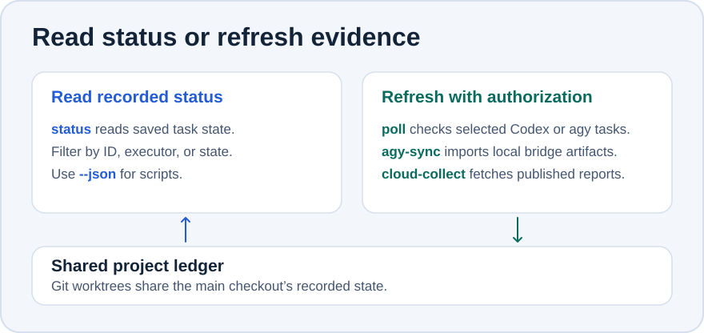

# Check task progress

`xq status` reads only the project ledger in the main Git checkout. Linked worktrees share the same view. You can read it before initializing the ledger. Set `xq` to the path of the installed helper. In Windows PowerShell, use `py -3 $xq` or your available Python command. [Direct CLI and PowerShell commands](installation.md#run-xq-directly)



## Read the ledger

```sh
python3 "$xq" status --open
python3 "$xq" status --id parser-tests
python3 "$xq" status --executor codex --state running --json
```

Filters combine. Use `--id` for an exact ledger ID, `--executor` for `codex`, `agy` or `cloud`, and `--state` for `queued`, `running`, `done`, `failed` or `blocked`. The `--open` view lists work still tracked as open for dispatch, review, integration or closure. Omit `--open` to include matching closed tasks.

The text output shows the task ID, executor, recorded state, verdict, reader and merge commit. `STALE` marks a running task with an extended gap in recorded activity. `CLOSED` marks an entry retired with `close`. A closed job that is still running can occupy a local launch slot until xq records its terminal outcome.

## Refresh recorded evidence

Use the installed helper to run an explicit refresh for the job or executor you are authorized to check. Run `status` again afterward to see the updated ledger.

| Executor | Refresh | What xq observes |
| --- | --- | --- |
| Codex | `xq poll --id parser-tests` or `xq poll --executor codex` | A recorded job via the Codex companion. The query can update its heartbeat or record its terminal result. |
| agy | `xq poll --id review-parser` or `xq poll --executor agy` | Local bridge queue and result artifacts. Direct delegates may have no observable state before their result is imported or recorded with `finish`. |
| Claude Code on the web | `xq cloud-collect --branch claude/session` | A report published on the selected Git branch. The report is evidence of a result and needs independent verification. |

`xq poll` without filters keeps its existing behavior of checking Codex and importing agy artifacts. Use `cloud-collect` separately when authorized to fetch the web session's Git branch. Use `agy-sync` for the direct-delegate exit and result procedure. Updates occur when you run the corresponding command. [agy result handling](agy.md) · [Web session collection](cloud.md)

## JSON output

Add `--json` to the same read-only status command. The top-level object contains `schema_version` and `tasks`. For example, a task waiting for dispatch includes these fields.

```json
{
  "schema_version": 1,
  "tasks": [
    {
      "id": "parser-tests",
      "executor": "codex",
      "attempt": 1,
      "state": "queued",
      "closed": false,
      "stale": false,
      "occupies_slot": false,
      "observation": null,
      "verdict": null,
      "merged": false
    }
  ]
}
```

`state` is the recorded task lifecycle. `observation` is the most recent recorded executor observation for this attempt. When present, it contains `source`, `state` and `observed_at`.

- `source` is `codex`, `agy` or `cloud`.
- The observation's `state` is `queued`, `running`, `done`, `failed`, `blocked`, `cancelled`, `unknown` or `unavailable`. Cloud reports provide terminal observations. `observation: null` means the ledger has no observation for that attempt.
- `verdict` records the independent review as `pass`, `fixes`, `reject` or `null`. `merged` reports whether the ledger has a merge record.
- `occupies_slot` accounts for a running Codex or agy assignment, including a closed entry pending terminal evidence.

An empty selection returns an empty `tasks` array. The data covers this project's ledger. Check the provider directly when you need jobs outside this ledger.

## Exit codes and effects

| Command | Exit 0 | Nonzero exit |
| --- | --- | --- |
| `status` | Read the ledger, including an empty selection. Leaves the ledger untouched. | Invalid input or a ledger access error. |
| `poll`, `agy-sync` | Completed the selected checks and recorded available observations or results. | At least one task could not be checked or a write conflict requires another refresh. Successfully checked tasks may already be recorded. |
| `cloud-collect` | Finished collection for the selected scope. | At least one branch, batch or local action requires attention. Other valid batches may already be recorded. |

Read `status` after a refresh to inspect the recorded outcome. The ledger reader reports malformed lines on stderr and skips them during replay. `doctor` checks requirements. `preflight` evaluates whether another local job fits the configured limits.
